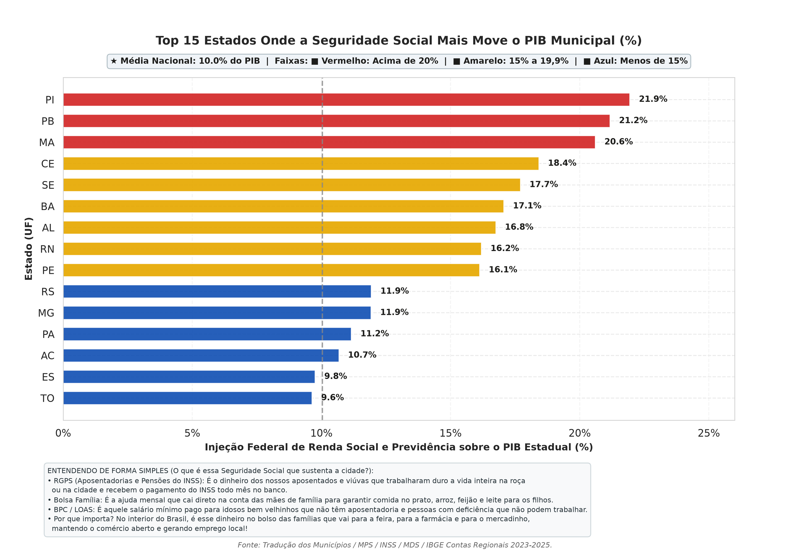
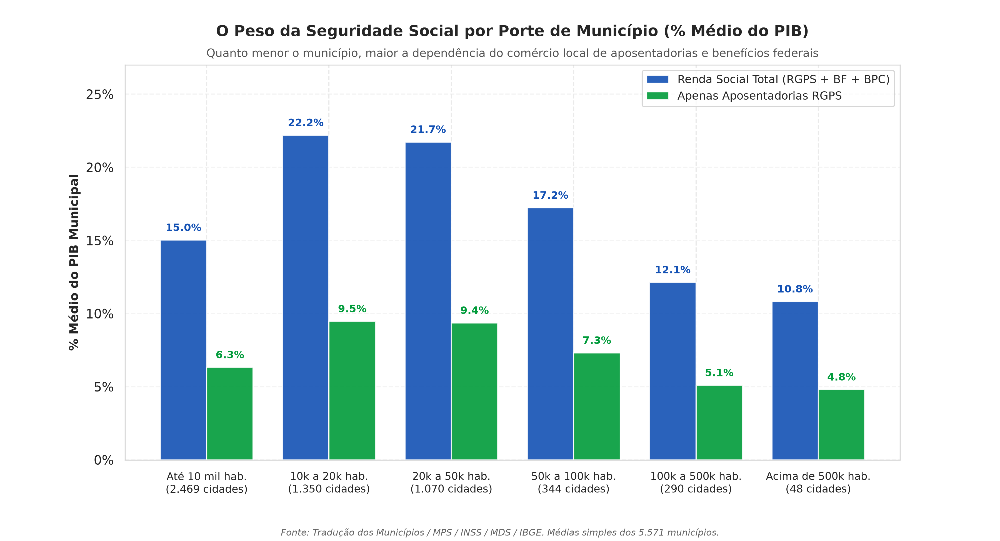
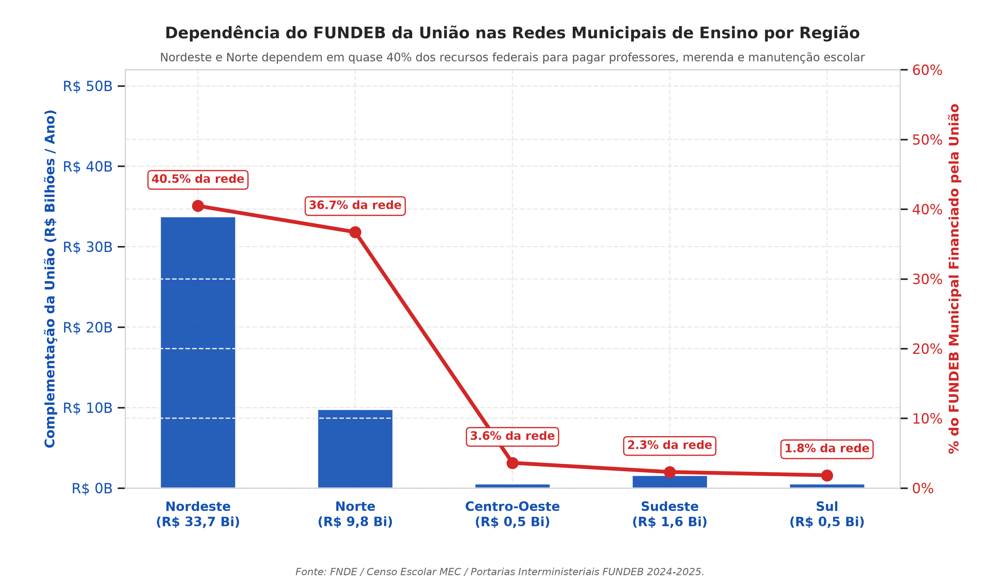
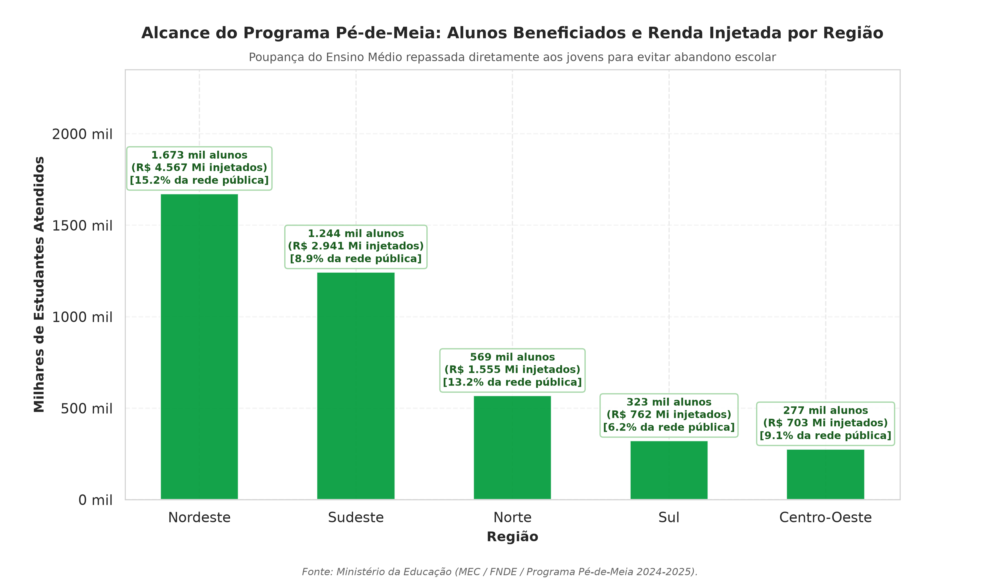
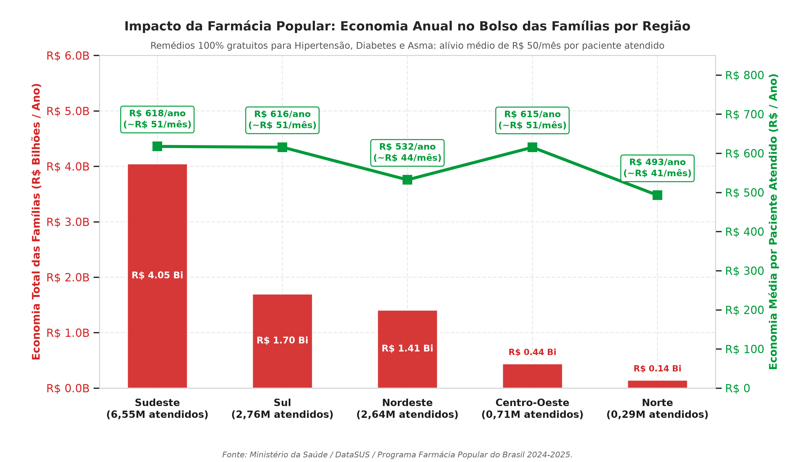
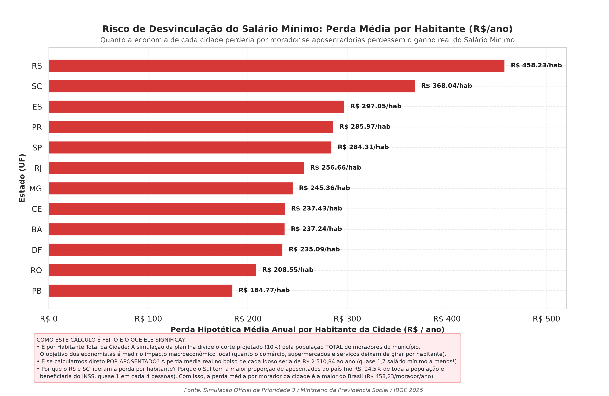
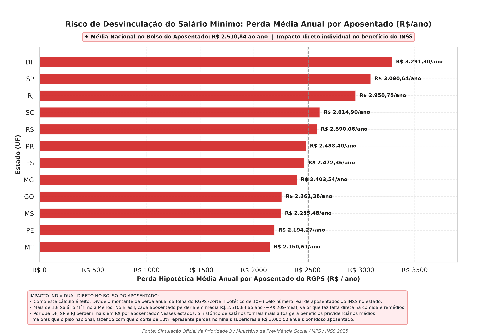

# 🇧🇷 Tradução para o Município & Séries Históricas do Brasil (2010–2025)

[](https://www.python.org/)
[](https://jupyter.org/)
[](https://pandas.pydata.org/)
[](https://seaborn.pydata.org/)
[](https://www.ibge.gov.br/)

> Repositório de inteligência de dados públicos conectando políticas públicas à vida real: Saúde, Educação, Previdência, Trabalho e Renda nos **5.571 municípios brasileiros**, combinado a **séries históricas econômicas e de poder de compra (2010–2025)**.

---

## 🧭 Sumário do Repositório

- [🎯 Visão Geral dos Cadernos](#-visão-geral-dos-cadernos)
- [📊 Galeria de Visualizações (Destaques Municipais)](#-galeria-de-visualizações-destaques-municipais)
- [💡 Principais Achados (Key Findings)](#-principais-achados-key-findings)
- [📖 Dicionário de Dados](#-dicionário-de-dados)
- [📁 Estrutura de Arquivos](#-estrutura-de-arquivos)
- [🚀 Como Executar Localmente](#-como-executar-localmente)
- [🏛️ Fontes Primárias](#️-fontes-primárias)

---

## 🎯 Visão Geral dos Cadernos

O repositório é estruturado em torno de dois cadernos principais de análise de dados:

### 1. [`analise_cruzamentos_municipios.ipynb`](analise_cruzamentos_municipios.ipynb)
- **Escopo:** Análise transversal dos **5.571 municípios do Brasil** cruzando dados demográficos, Produto Interno Bruto (PIB), Previdência Social (RGPS), Bolsa Família, Benefício de Prestação Continuada (BPC/LOAS), Carteiras Assinadas (CLT), Microempreendedores Individuais (MEI), FUNDEB (MEC/FNDE), Programa Pé-de-Meia e Farmácia Popular (DataSUS).
- **Foco:** Transformar estatísticas macroeconômicas na resposta direta para o cidadão comum: *"O que essa política pública representa na prática para a economia da minha cidade e para a mesa da minha família?"*.
- **Base de Dados:** [`traducao_municipios_consolidado.xlsx`](traducao_municipios_consolidado.xlsx) (72 colunas auditadas).

### 2. [`series_historicas_brasil_2010_2025.ipynb`](series_historicas_brasil_2010_2025.ipynb)
- **Escopo:** Séries temporais históricas mensais e anuais abrangendo os ciclos dos governos Dilma, Temer, Bolsonaro e Lula 3.
- **Dimensões Acompanhadas:** 
  - Mercado Automotivo (Veículos Novos vs. Usados e a razão Fenabrave/Fenauto).
  - Mercado Imobiliário (Crédito Imobiliário SBPE e Habitação).
  - Varejo e Consumo (Índices PMC/IBGE e ICV).
  - Agronegócio e Balança Comercial (Safras CONAB e Exportações Agropecuárias).
  - Mercado de Trabalho (Estoque formal CLT Novo CAGED e formalização MEI).
  - Poder de Compra das Famílias (Cesta Básica DIEESE, Botijão de Gás ANP, Gasolina Comum ANP e Aluguel Residencial FipeZap ponderados pelo Salário Mínimo).
- **Base de Dados:** [`series_historicas_brasil_2010_2025.xlsx`](series_historicas_brasil_2010_2025.xlsx).

---

## 📊 Galeria de Visualizações (Destaques Municipais)

Os gráficos abaixo foram gerados com estilização editorial via **Matplotlib** e **Seaborn**, paleta de cores balanceada, anotações de contexto socioeconômico e alta resolução (300 DPI):

### 1. Dependência da Renda Social e Previdenciária no PIB Estadual
> *Explica em linguagem simples o impacto combinado de Aposentadorias do INSS, Bolsa Família e BPC na economia dos estados.*


### 2. Peso da Seguridade Social por Porte Populacional
> *Demonstra como nas cidades pequenas (até 10.000 hab.), a seguridade social responde por mais de 25% de toda a riqueza municipal gerada.*


### 3. Dependência do FUNDEB da Complementação da União
> *Evidencia o papel do Governo Federal na manutenção de escolas públicas, merenda e salários de professores no Norte e Nordeste.*


### 4. Alcance do Programa Pé-de-Meia por Grande Região
> *Distribuição dos mais de 4 milhões de estudantes do ensino médio público amparados pela poupança da juventude.*


### 5. Farmácia Popular: Economia Real no Bolso Familiar
> *R$ 7,75 bilhões de alívio anual no bolso das famílias e economia média de ~R$ 50/mês por paciente atendido com remédios para pressão, diabetes e asma.*


### 6. Risco de Desvinculação do Salário Mínimo: Perda Média por Habitante da Cidade
> *Impacto macroeconômico local no comércio e circulação de dinheiro por habitante no município.*


### 7. Risco de Desvinculação do Salário Mínimo: Perda Individual por Aposentado
> *O impacto direto no contracheque: simulação de perda de R$ 2.510,84 ao ano (~R$ 209/mês ou 1,7 salário mínimo por ano) no bolso do aposentado.*


---

## 💡 Principais Achados (Key Findings)

Para a leitura aprofundada de todas as conclusões, consulte o documento completo em:  
👉 **[`docs/PRINCIPAIS_ACHADOS.md`](docs/PRINCIPAIS_ACHADOS.md)**

### Síntese Executiva:
1. **Seguridade Social como Sustentáculo Econômico:** No Piauí, Paraíba e Maranhão, a soma de RGPS, Bolsa Família e BPC supera **20% do PIB de todos os municípios**. Nas cidades brasileiras com até 10 mil habitantes, a média atinge **25,6% do PIB local**.
2. **Educação e Pacto Federativo:** No Nordeste (**40,5%**) e no Norte (**36,7%**), quase metade dos recursos da educação básica municipal depende do aporte financeiro da União via complementação do FUNDEB.
3. **Pé-de-Meia:** Mais de **1,67 milhão de jovens** no Nordeste e **1,24 milhão** no Sudeste recebem a poupança estudantil, combatendo a evasão escolar precoce.
4. **Farmácia Popular:** Mais de **R$ 7,74 bilhões** de reais deixaram de sair do bolso das famílias com a gratuidade de remédios contínuos, representando alívio médio de **R$ 530 a R$ 618 por paciente atendido ao ano** (~R$ 50 mensais).
5. **Risco da Desvinculação Previdenciária:** A perda da paridade das aposentadorias com o ganho real do salário mínimo provocaria um corte médio de **R$ 2.510,84 por aposentado ao ano** (equivalente a 1,7 salários mínimos a menos anualmente).
6. **Poder de Compra (2010–2025):** 
   - A **cesta básica**, que exigia **59,3% do salário mínimo em 2021**, recuou para **~53,1% em 2024**.
   - O **botijão de gás 13kg**, que atingiu o pico de **9,3% do salário mínimo em 2021/2022**, baixou para **6,9% em 2024**.
   - A **gasolina comum** caiu de **0,55% do SM/litro** para **0,42% do SM/litro** após o encerramento da Paridade de Preços de Importação (PPI) pela Petrobras em maio de 2023.

---

## 📖 Dicionário de Dados

A especificação detalhada de todas as variáveis, unidades de medida, métodos de agregação e fontes governamentais está documentada em:  
👉 **[`docs/DICIONARIO_DE_DADOS.md`](docs/DICIONARIO_DE_DADOS.md)**

O dicionário abrange:
- **Demografia e Identificação:** Códigos IBGE (6 e 7 dígitos), UF, Macrorregião, População 2025 e PIB a preços correntes.
- **Previdência Social:** Quantidade e valores do RGPS, benefícios rurais, participação no PIB e cenários de simulação fiscal.
- **Trabalho e Transferência de Renda:** Carteiras assinadas CLT, MEIs ativos, famílias do Bolsa Família e beneficiários do BPC/LOAS.
- **Educação Básica:** Matrículas na rede pública, volume do FUNDEB municipal, complementação da União e beneficiários do Pé-de-Meia.
- **Saúde e Medicamentos:** Pacientes e economia estimada da Farmácia Popular, atendimentos de oncologia, HIV e hemodiálise.
- **Séries Históricas:** Frotas de veículos novos e usados, crédito SBPE, postos CLT, MEIs, índices de cesta básica DIEESE, combustíveis ANP e locação residencial FipeZap.

---

## 📁 Estrutura de Arquivos

```bash
trad_x_municipio/
│
├── analise_cruzamentos_municipios.ipynb    # Notebook principal: Análise dos 5.571 municípios
├── series_historicas_brasil_2010_2025.ipynb # Notebook: Séries temporais históricas (2010-2025)
│
├── traducao_municipios_consolidado.xlsx     # Planilha consolidada das 4 prioridades (5.571 municípios)
├── series_historicas_brasil_2010_2025.xlsx  # Planilha com séries temporais e preços relativos
│
├── graficos_municipios/                     # Imagens dos gráficos em 300 DPI
│   ├── grafico_1_dependencia_pib_estados.png
│   ├── grafico_2_peso_seguridade_porte_cidades.png
│   ├── grafico_3_fundeb_uniao_regioes.png
│   ├── grafico_4_pe_de_meia_regioes.png
│   ├── grafico_5_farmacia_popular_economia_bolso.png
│   ├── grafico_6_perda_desvinculacao_salario_minimo.png
│   └── grafico_7_perda_desvinculacao_por_aposentado.png
│
├── docs/                                    # Documentação técnica e analítica
│   ├── DICIONARIO_DE_DADOS.md               # Dicionário de dados das 72 colunas e séries
│   └── PRINCIPAIS_ACHADOS.md                # Relatório executivo completo de achados
│
├── .gitignore                               # Exclusão de caches, venvs e builds
└── README.md                                # Apresentação do projeto e guia de uso
```

---

## 🚀 Como Executar Localmente

### 1. Clonar o repositório
```bash
git clone https://github.com/<SEU_USUARIO>/trad_x_municipio.git
cd trad_x_municipio
```

### 2. Criar e ativar o ambiente virtual (Python 3.10+)
```bash
python3 -m venv venv
source venv/bin/activate  # No Windows: venv\Scripts\activate
```

### 3. Instalar as dependências necessárias
```bash
pip install pandas numpy openpyxl matplotlib seaborn jupyter ipykernel
```

### 4. Executar os Cadernos Jupyter
Você pode abrir e rodar os notebooks diretamente no **VS Code / Antigravity IDE** ou iniciar a interface web do Jupyter:
```bash
jupyter notebook
```
> **Dica no VS Code:** Ao abrir `analise_cruzamentos_municipios.ipynb`, clique no botão **"Select Kernel"** no canto superior direito e aponte para o Python do seu ambiente virtual.

---

## 🏛️ Fontes Primárias

Os dados consolidados neste projeto foram extraídos e tratados a partir de bases oficiais e abertas do Estado brasileiro e entidades de pesquisa:
- **IBGE:** Censo Demográfico, Projeções Populacionais e Contas Regionais do PIB Municipal.
- **Ministério da Previdência Social (MPS / INSS):** Boletim Estatístico da Previdência Social e Censo Previdenciário.
- **Ministério do Desenvolvimento e Assistência Social (MDS / SAGICAD):** Folhas de pagamento do Bolsa Família e do BPC/LOAS.
- **Ministério do Trabalho e Emprego (MTE):** Novo CAGED e RAIS.
- **Ministério da Educação (MEC / INEP / FNDE):** Censo Escolar, Repasses do FUNDEB e Programa Pé-de-Meia.
- **Ministério da Saúde (MS / DataSUS):** Sistema de Informações Ambulatoriais (SIA/SUS), Farmácia Popular e CEAF.
- **Entidades Setoriais:** DIEESE (Cesta Básica), ANP (Preços de Combustíveis e Gás GLP), FipeZap (Locação Residencial), ABECIP (Crédito Imobiliário), Fenabrave e Fenauto (Veículos).

---
*Desenvolvido com foco em transparência pública, rigor metodológico e visualização de dados acessível.*
