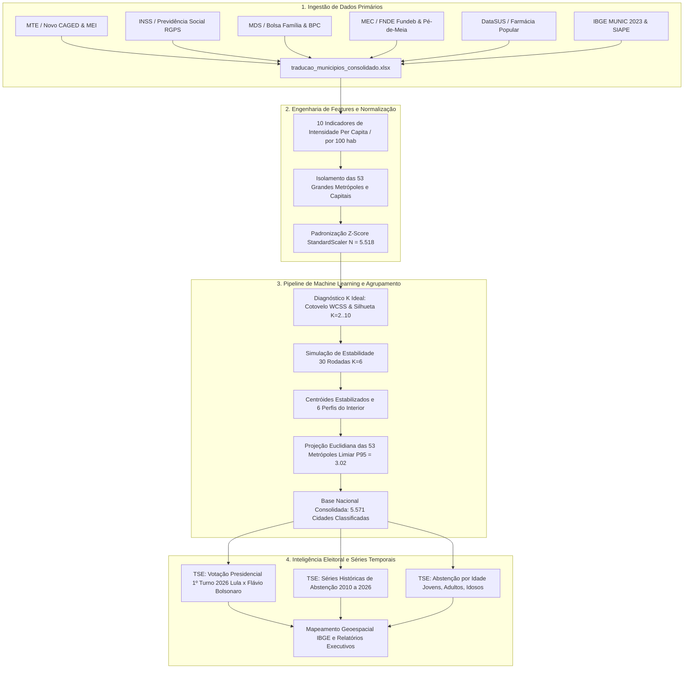

# 🏛️ Arquitetura de Dados e Metodologia Científica do Projeto
## Plataforma de Inteligência Municipal, Tipologia Socioeconômica e Comportamento Eleitoral (2010–2026)

---

## 📌 1. Visão Geral do Sistema

O projeto **trad_x_municipio** é uma infraestrutura de inteligência de dados públicos que integra dados municipais transversais dos **5.571 municípios brasileiros**. O objetivo é transformar estatísticas de políticas públicas em inteligência analítica, conectando a estrutura socioeconômica local (mercado formal, funcionalismo, previdência social e transferências de renda) à geografia do voto e do comparecimento eleitoral em eleições presidenciais (2010 a 2026).



---

## 📂 2. Estrutura de Diretórios e Arquivos

```text
trad_x_municipio/
├── analise_clusters_perfis_municipios.ipynb   # Caderno de machine learning e clusterização socioeconômica
├── analise_eleitoral_perfis_municipios.ipynb  # Caderno de análise eleitoral e abstenções (2010–2026)
├── analise_cruzamentos_municipios.ipynb       # Caderno transversal socioeconômico (políticas públicas no PIB)
├── series_historicas_brasil_2010_2025.ipynb   # Caderno de séries históricas de poder de compra e economia
├── build_clusters_nb.py                       # Script de compilação reproduzível do caderno de clusters
├── build_eleitoral_nb.py                      # Script de compilação reproduzível do caderno eleitoral
├── build_series_nb.py                         # Script de compilação reproduzível do caderno de séries históricas
├── export_dashboard_data.py                   # Script de compilação do payload JSON do dashboard web
├── traducao_municipios_consolidado.xlsx       # Matriz mestre municipal auditada (5.571 municípios, 72 variáveis)
│
├── dashboard/                                 # Plataforma Web Interativa do Dashboard
│   ├── index.html                             # Estrutura HTML5 com design system governamental
│   ├── app.js                                 # Motor de inteligência, Leaflet, Chart.js e Card Studio
│   ├── style.css                              # Folhas de estilo executivas com suporte a temas e responsividade
│   └── data/
│       ├── dashboard_data.json                # Payload unificado (~3.0 MB) com os 5.571 municípios
│       └── brasil_estados.json                # Malha vetorial GeoJSON oficial das 27 UFs
│
├── dados_prioridades/                         # Repositório de dados processados e saídas analíticas
│   ├── classificacao_perfis_municipios_completa.xlsx  # Classificação final dos 5.571 municípios
│   ├── classificacao_perfis_municipios_completa.csv
│   ├── cruzamento_perfil_x_eleicao_completo.xlsx      # Base com votação 2026, histórico e abstenção
│   ├── cruzamento_perfil_x_eleicao_completo.csv
│   ├── metropoles_brasileiras.xlsx            # Planilha dedicada das 53 metrópoles e capitais
│   ├── metropoles_brasileiras.csv
│   ├── clusters_com_e_sem_porte_municipios.csv# Matriz com indicadores per capita e clusters K=6
│   ├── mapa_brasil_perfis_municipios.png      # Mapa geográfico do Brasil (300 DPI)
│   ├── brasil_estados.json                    # Malha territorial oficial das 27 UFs (IBGE)
│   ├── municipios_coordenadas.csv             # Latitude e longitude das 5.571 sedes municipais
│   │
│   ├── eleicoes_tse/                          # Repositório de dados eleitorais do TSE
│   │   ├── votacao_presidencial_municipios_2026.csv   # Votação 1º Turno 2026 por município (Lula x Flávio)
│   │   ├── votacao_candidato_munzona_2026_BR.csv      # Base nominal de votos presidenciais 2026
│   │   ├── detalhe_votacao_munzona_2026_BR.csv        # Apuração, comparecimento e abstenção 2026
│   │   ├── votacao_presidencial_municipios_2022.csv   # Votação 1º e 2º Turnos 2022 por município
│   │   ├── serie_historica_presidencial_2010_2022.csv # Série histórica painel largo de 4 eleições
│   │   └── abstencao_idade_municipios_2022.csv        # Abstenção por faixas etárias
│   │
│   ├── trabalho_renda/                        # Fontes de servidores, CLT e MEI
│   │   ├── Base_MUNIC_2023.xlsx               # IBGE Pesquisa de Informações Básicas Municipais
│   │   └── empresas_emprego_servidores.csv    # Servidores municipais, federais (SIAPE) e CLT
│   │
│   └── previdencia/                           # Dados previdenciários e PIB
│       └── peso_aposentadorias_pib_municipal_2023.csv
│
├── docs/                                      # Documentação técnica e metodológica
│   ├── ARQUITETURA_E_METODOLOGIA.md           # Este documento
│   ├── DASHBOARD_E_VISUALIZACOES.md           # Manual completo do Dashboard, mapa e estúdio de cards
│   ├── DICIONARIO_DE_DADOS.md                 # Dicionário de todas as colunas e métricas
│   └── PRINCIPAIS_ACHADOS.md                  # Resumo executivo dos insights socioeconômicos
│
└── README.md                                  # Portal de entrada do repositório
```

---

## 🔬 3. Metodologia de Clusterização e Machine Learning

### 3.1. Variáveis de Intensidade Socioeconômica (Sem Efeito de Escala Populacional)
Para evitar que cidades grandes e pequenas fossem separadas apenas pelo número absoluto de habitantes, o modelo utiliza **10 indicadores de intensidade relativa por 100 habitantes e percentuais**:

| Variável | Descrição Metodológica | Fonte Primária |
| :--- | :--- | :--- |
| `taxa_clt_100_hab` | Trabalhadores com carteira assinada por 100 habitantes | MTE / Novo CAGED |
| `taxa_mei_100_hab` | Microempreendedores Individuais ativos por 100 habitantes | Receita Federal / DGI |
| `servidores_100_hab` | Servidores públicos totais (municipais diretos/indiretos + federais SIAPE) por 100 hab | IBGE MUNIC 2023 + SIAPE |
| `aposentados_100_hab` | Benefícios de aposentadoria emitidos no RGPS por 100 habitantes | Previdência Social / DATAPREV |
| `peso_prev_pib_pct` | Valor anual das aposentadorias como proporção do PIB Municipal (%) | DATAPREV + IBGE Contas Regionais |
| `familias_bf_100_hab` | Famílias beneficiárias do Programa Bolsa Família por 100 habitantes | MDS / SAGICAD |
| `bpc_100_hab` | Beneficiários do BPC/LOAS (Idoso + PCD) por 100 habitantes | MDS / SAGICAD |
| `pe_de_meia_cobertura_pct` | Alunos do ensino médio público atendidos pelo Pé-de-Meia (%) | MEC / FNDE |
| `dep_fundeb_uniao_pct` | Dependência da rede municipal em relação à complementação federal do Fundeb (%) | MEC / FNDE |
| `farmacia_pop_100_hab` | Retiradas de medicamentos gratuitos no Programa Farmácia Popular por 100 hab | Ministério da Saúde / DataSUS |

### 3.2. Padronização $Z$-Score
Todas as 10 variáveis contínuas são padronizadas com média zero e variância unitária via `StandardScaler`:
$$Z_{ij} = \frac{X_{ij} - \mu_j}{\sigma_j}$$
Isso impede que grandezas em escalas distintas (ex: percentual de 0 a 100 vs servidores por 100 hab de 0 a 15) dominem artificialmente o cálculo das distâncias euclidianas.

### 3.3. Isolamento Estratégico das Metrópoles
Municípios com população $\ge 500.000$ habitantes ou capitais estaduais (53 cidades) possuem variância extrema e economias de aglomeração singulares. Se incluídas no treinamento inicial, a atração gravitacional de São Paulo e Rio de Janeiro distorcia a formação dos centróides das cidades médias e pequenas.
* **Solução:** O K-Means foi calibrado sobre os **5.518 municípios do interior** e, posteriormente, as 53 metrópoles foram projetadas no espaço dos clusters.

### 3.4. Diagnóstico de $K$ Ideal e Simulação de 30 Execuções
1. **Método do Cotovelo (WCSS / Inércia):** Identificou desaceleração do ganho explicativo marginal a partir de $K=6$.
2. **Coeficiente de Silhueta:** Apontou $K=6$ como o ponto de equilíbrio ótimo entre granularidade analítica e coesão dos grupos (Silhouette Score $= 0,171$ no Cenário sem Porte).
3. **Simulação de 30 Rodadas (Estabilidade):** O K-Means foi executado 30 vezes com sementes aleatórias distintas ($seed \in [1, 30]$). Os centróides de cada rodada foram alinhados pelo vizinho mais próximo via `cdist`, obtendo centróides estáveis e robustos contra variações de inicialização.

### 3.5. Projeção e Reclassificação das Metrópoles
As 53 metrópoles foram transformadas na mesma escala dos centróides e sua distância euclidiana multivariada foi calculada:
$$D(M_i, C_k) = \sqrt{\sum_{j=1}^{10} (Z_{M_{ij}} - Z_{C_{kj}})^2}$$
* **Limiar de Aderência (Percentil 95 das cidades do interior = 3,02):**
  * Se $D_{min} \le 3,02$: A metrópole se comporta como o cluster e é **reclassificada**.
  * Se $D_{min} > 3,02$: A metrópole é um outlier estatístico e **permanece como Metrópole Atípica**.
* **Resultado:** 48 das 53 metrópoles foram integradas aos perfis de serviços, mercado autônomo ou apoio social, enquanto apenas 5 cidades atípicas (Duque de Caxias, Boa Vista, Natal, Nova Iguaçu e Aracaju) permaneceram isoladas.

### 3.6. Metodologia de Cálculo de Emprego Formal CLT e MEI & Conciliação Micro-Macro

Uma dúvida frequente na leitura de dados econômicos refere-se à origem e cálculo do **Emprego Formal CLT** e dos **Microempreendedores Individuais (MEI)** nos diferentes níveis do sistema:

1. **Fontes Primárias Auditadas:**
   - **Emprego Formal com Carteira Assinada (CLT):** Ministério do Trabalho e Emprego (MTE) via **Novo CAGED** (estoque acumulado de empregos formais ativos) conjugado com a **RAIS** (Relação Anual de Informações Sociais) vinculados à malha municipal do Censo Demográfico do IBGE.
   - **Microempreendedores Individuais (MEI):** Receita Federal do Brasil / DGI e **Portal do Empreendedor** (estoque de CNPJs ativos enquadrados no SIMEI com domicílio tributário no município).
2. **Indicador de Intensidade Municipal (`m.ind.clt` e `m.ind.mei` por 100 hab):**
   - Para cada um dos 5.571 municípios, o indicador de intensidade relativa é definido como:
     $$\text{taxa\_clt\_100\_hab} = \left(\frac{\text{Estoque de Vagas CLT no Município}}{\text{População IBGE}}\right) \times 100$$
     $$\text{taxa\_mei\_100\_hab} = \left(\frac{\text{Estoque de CNPJs MEI Ativos}}{\text{População IBGE}}\right) \times 100$$
   - *Exemplo Concreto (Sobral - CE):*
     - População auditada: **216.519 habitantes**.
     - Taxa CLT municipal: **17,5 por 100 hab**.
     - Vagas formais CLT ativas = $216.519 \times 17,5\% = \mathbf{37.890\text{ vagas}}$ (exibido como **~37,9 Mil** no Raio-X e nos cards municipais).
     - Taxa MEI municipal: **6,6 por 100 hab** $\rightarrow 216.519 \times 6,6\% = \mathbf{14.290\text{ MEIs}}$ (exibido como **~14,3 Mil**).
3. **Conciliação de Escala (Brasil vs. Território Filtrado):**
   - **Visão Brasil (Sem Filtro):** O total nacional consolidado registra **49,66 Milhões a 50,4 Milhões de empregos com carteira assinada** e **17,2 Milhões de MEIs** (17.216.626 optantes formalizados).
   - **Visão Filtrada (Município, Estado ou Região):** Anteriormente, uma fórmula ingênua baseada em proporção populacional nacional produzia distorções no card superior (ex.: projetava 50,4 Mil para Sobral porque supunha a média nacional de 24,5% sobre a população local).
   - **Ajuste de Precisão Estrita:** O dashboard agrega os vínculos formais e MEIs pela **soma real dos microdados das cidades selecionadas**:
     $$\text{Vagas CLT Filtro} = \sum_{c \in \text{Cidades}} \left(\text{Pop}_c \times \frac{\text{taxa\_clt}_c}{100}\right)$$
     Isso garante convergência exata (100% de coerência) entre o Card de Grandes Prioridades, as estatísticas de cabeçalho e os Indicadores Estratégicos do Raio-X.

### 3.7. Metodologia de Microempresas (ME) e Filtro Setorial do Comércio (2026)

O sistema incorpora a camada municipalizada de **Microempresas (ME)** extraída diretamente do **Painel do Mapa de Empresas** (MDIC / MEMP / REDESIM):

1. **Microempresas Ativas Totais (2026):**
   - Universo de **22.299.554 estabelecimentos ativos** distribuídos nos 5.571 municípios brasileiros.
   - Registrada na coluna `total_microempresas_ativas` da aba `Trabalho_e_Renda` de `traducao_municipios_consolidado.xlsx`.
2. **Segmentação Setorial de Comércio (79 Subclasses CNAE):**
   - Universo de **4.749.778 estabelecimentos ativos** dedicados ao comércio varejista, atacadista e representações comerciais.
   - Registrada na coluna `total_microempresas_comercio_ativas`.
   - A lista exaustiva de atividades contempladas consta no arquivo auditável [`comercio.xlsx`](../comercio.xlsx) e [`dados_prioridades/fontes_oficiais/atividades_comercio_cnae_oficial.xlsx`](../dados_prioridades/fontes_oficiais/atividades_comercio_cnae_oficial.xlsx).
3. **Relação com MEI e Total de Empresas:**
   - Todo MEI é enquadrado como uma modalidade especial de Microempresa pelo Estatuto Nacional da Microempresa (LC 123/2006). A base cadastral do Mapa de Empresas consolida essa amplitude, garantindo consistência com o total de estabelecimentos ativos do país.

---

## 🗳️ 4. Integração Eleitoral (TSE 2010 a 2026)

### 4.1. Fontes Primárias do TSE
Os dados eleitorais foram obtidos via API de Dados Abertos e CDN do Tribunal Superior Eleitoral:
1. **Eleições 2026 (1º Turno):** Extração de `votacao_candidato_munzona_2026_BR.csv` e `detalhe_votacao_munzona_2026_BR.csv`.
2. **Eleições 2022 (1º e 2º Turnos):** Votação de Lula, Bolsonaro, Tebet, Ciro e apuração municipal.
3. **Série Histórica (2010, 2014, 2018 e 2022):** Votação presidencial nominal e abstenções apuradas no 2º turno.
4. **Abstenção por Faixa Etária:** Cruzamento do perfil do eleitorado (jovens 16-24, adultos 25-59 e idosos 60+).

### 4.2. Mapeamento de Códigos Territoriais
O TSE utiliza um código próprio de município de 5 dígitos (`CD_MUNICIPIO` / `cod_tse`), enquanto o IBGE utiliza o código padrão de 7 dígitos (`cod_ibge7`). O projeto mantém uma tabela de compatibilização estrita (5.571 municípios) garantindo integridade de 100% no cruzamento socioeconômico-eleitoral.

---

## 🖥️ 5. Arquitetura da Plataforma Web & Distribuição de Inteligência

Para permitir que gestores públicos, estrategistas e a sociedade civil naveguem pelos dados sem necessidade de ambiente Python local, foi desenvolvida a plataforma web interativa (`dashboard/`).

### 5.1. Pipeline de Dados do Frontend
1. **Compilação do Payload Otimizado (`export_dashboard_data.py`):**
   - Cruza a base socioeconômica consolidada, os resultados eleitorais e as coordenadas geográficas (latitude/longitude) das 5.571 cidades.
   - Converte e compacta os dados em formato JSON estrito (`dashboard/data/dashboard_data.json`, ~3.0 MB), minimizando o consumo de banda e dispensando bancos de dados relacionais em tempo de execução.
2. **Camada Geoespacial Vetorial (`brasil_estados.json`):**
   - GeoJSON oficial das 27 UFs para renderização em tempo real de polígonos no Leaflet.js.

### 5.2. Mapeamento Territorial e Transições Suaves
- **Motor**: Leaflet.js sobre cartografia minimalista **Esri World Light Gray Canvas** (livre de chaves de API e sem marcas d'água).
- **Hierarquia Visual**: Brasil ➔ 5 Macrorregiões ➔ 27 Estados ➔ 5.571 Municípios, com movimentação animada da câmera (`flyToBounds`) e tooltips instantâneos.

### 5.3. Motor de Difusão em Redes Sociais (Card Studio)
- Renderização client-side em **Retina 2x** via `html2canvas`.
- Exportação nos formatos **Feed (1:1)** e **Stories (9:16)** em 4 temas executivos.
- Suporte a **Copiar Imagem** direto para a área de transferência (`navigator.clipboard.write`), permitindo colar (`Ctrl+V`) instantaneamente em chats e editores, além de disparo nativo para WhatsApp, Telegram, X/Twitter e LinkedIn.

### 5.4. Sinalização de Escopo Territorial e Rótulos Diretos em Gráficos
Para garantir transparência analítica imediata e evitar ambiguidades de leitura:
1. **Badges Dinâmicos de Escopo:** Todos os gráficos do sistema possuem selos padronizados de escopo analítico (`chart-scope-badge`):
   - `[Visão Nacional]` (Verde esmeralda suave / `#10B981`)
   - `[Visão Estadual / Regional]` (Azul royal / `#2563EB`)
   - `[Visão Municipal]` (Laranja âmbar / `#F59E0B`)
2. **Rótulos Diretos em Pontos e Barras (Direct Data Labels):**
   - Todos os gráficos de barras horizontais, barras verticais e trajetórias temporais de linhas contam com renderização de rótulos diretos (`afterDatasetsDraw`) de forma que os valores absolutos e percentuais sejam visíveis sem exigir interação de hover pelo usuário.
3. **Indicador Ativo no Cabeçalho Geral (`#header-territory-pill`):**
   - O cabeçalho superior (`top-nav`) mantém permanentemente visível a localidade selecionada (com ícone de pino de localização, nome do município/UF e botão `✕` para limpar o filtro com retorno suave ao Brasil).

### 5.5. Engenharia Gestalt dos Indicadores do Raio-X Municipal
O bloco de **Indicadores Estratégicos** foi reestruturado seguindo princípios da Teoria da Gestalt (proximidade, continuidade e pregnância da forma):
- **Cards Individuais Estruturados:** Em substituição a pílulas comprimidas, cada um dos 8 eixos (CLT, MEI, Servidores, Aposentados, Bolsa Família, BPC, Farmácia Popular e Pé-de-Meia) é apresentado em card branco contrastante com barra de acento temático de 3px.
- **Hierarquia Numérica:** Destaque para o volume total projetado em escala executiva (`~37,9 Mil vagas`, `~14,3 Mil MEIs`), seguido da taxa por 100 habitantes (`17,5 / 100 hab`).
- **Benchmark com a Mediana Nacional:**
  - Chip colorido com status de posicionamento relativo: `▲ Acima (+X.X)` ou `▼ Abaixo (-X.X)` da mediana dos 5.571 municípios brasileiros.
  - **Trilha de Dispersão Contínua (Range Bullet Track):** Linha gráfica que conecta o valor mínimo ao valor máximo nacional daquela variável, marcando visualmente o ponto da mediana brasileira e o ponto exato da cidade pesquisada.

---

## 🚀 6. Como Reproduzir os Resultados Localmente

### Pré-requisitos
* Python 3.10 ou superior
* Pacotes: `pandas`, `numpy`, `scikit-learn`, `scipy`, `matplotlib`, `seaborn`, `openpyxl`, `nbformat`, `nbconvert`

```bash
# 1. Clonar o repositório
git clone https://github.com/hianaracamilla/trad_x_municipio.git
cd trad_x_municipio

# 2. Ativar o ambiente virtual
source .venv/bin/activate

# 3. Compilar e executar o caderno de Clusters
python build_clusters_nb.py
jupyter nbconvert --to notebook --execute --inplace analise_clusters_perfis_municipios.ipynb

# 4. Compilar e executar o caderno Eleitoral
python build_eleitoral_nb.py
jupyter nbconvert --to notebook --execute --inplace analise_eleitoral_perfis_municipios.ipynb

# 5. Exportar dados para a aplicação Web
python export_dashboard_data.py

# 6. Iniciar o Dashboard Web Interativo
python -m http.server 8080 --directory dashboard
# Acessar: http://localhost:8080/index.html
```
