# 🖥️ Plataforma Web & Dashboard Interativo de Inteligência Municipal
## Documentação Completa da Interface, Mapeamento Geoespacial e Estúdio de Cards

---

## 📌 1. Visão Geral da Aplicação

O **Dashboard de Inteligência Municipal** (`dashboard/`) é uma plataforma web interativa moderna, responsiva e de alta performance criada para tornar acessíveis e visuais os dados dos **5.571 municípios brasileiros**, conectando os investimentos do Governo Federal em **Saúde, Educação, Previdência e Emprego** ao comportamento eleitoral (Eleições 2022 e 2026) e à evolução macroeconômica do poder de compra das famílias (2016 a 2026).

```mermaid
flowchart LR
    subgraph B1 [Bases e Modelos]
        M1[traducao_municipios_consolidado.xlsx]
        M2[classificacao_perfis_municipios_completa.xlsx]
        M3[cruzamento_perfil_x_eleicao_completo.xlsx]
        M4[series_historicas_brasil_2010_2025.xlsx]
    end

    subgraph B2 [ETL de Exportação]
        E1[export_dashboard_data.py]
    end

    subgraph B3 [Payload Otimizado]
        J1[dashboard_data.json ~3.0 MB]
        J2[brasil_estados.json GeoJSON]
    end

    subgraph B4 [Frontend Web - Zero Dependências Pesadas]
        F1[index.html & style.css]
        F2[app.js - Vanilla JS]
        F3[Leaflet.js + Esri Canvas Basemap]
        F4[Chart.js - Visualizações Analíticas]
        F5[html2canvas - Estúdio de Cards 2x Retina]
    end

    subgraph B5 [Canais de Saída e Distribuição]
        S1[WhatsApp & Telegram]
        S2[Instagram Feed 1:1 & Stories 9:16]
        S3[Twitter / X & LinkedIn]
        S4[Web Share API Mobile]
    end

    B1 --> B2
    B2 --> B3
    B3 --> B4
    B4 --> B5
```



---

## 🎨 2. Identidade Visual e Filosofia de Design

A interface foi projetada seguindo as melhores práticas internacionais de design governamental e executivo, com foco em:

1. **Paleta Institucional Oficial**:
   - **Verde Brasil**: `#009739` / `#007A2E` (identidade nacional e destaques positivos).
   - **Azul Profundo**: `#0B2545` / `#134074` / `#002776` (sobriedade, autoridade e contraste).
   - **Amarelo Ouro**: `#FEDD00` / `#D4A017` (indicadores e atenções estratégicas).
   - **Terracota Institucional Sóbrio**: `#B84A39` / `#94382A` (utilizado na visualização dos candidatos de partidos progressistas como Lula/PT, em substituição ao vermelho saturado tradicional, garantindo harmonia visual e neutralidade executiva).
   - **Azul Oposição**: `#2563EB` / `#1D4ED8` (para candidatos conservadores/oposição, como Bolsonaro e Flávio Bolsonaro).
2. **Design Responsivo e Escuro/Claro Suave**:
   - Backgrounds profundos em tons ardósia (`#0B132B`, `#0D1B2A`, `#1E293B`) com efeitos de vidro (*glassmorphism*) e bordas discretas em degradê (`rgba(255, 255, 255, 0.08)`).
3. **Tipografia Moderna**:
   - Famílias *Outfit* e *Plus Jakarta Sans* (Google Fonts), conferindo legibilidade instantânea em números grandes e textos densos.
4. **Engenharia de Percepção (Teoria da Gestalt)**:
   - Agrupamento visual por proximidade, contraste cromático hierárquico e continuidade linear para destacar desvios em relação à mediana nacional e facilitar a assimilação de dados complexos.

---

## 🧭 2.1. Navegação, Cabeçalho Dinâmico e Sinalização de Escopo

### Chip de Filtro Ativo no Cabeçalho (`#header-territory-pill`)
- Localizado no topo superior fixo (`top-nav`), exibe de forma permanente a localidade filtrada com ícone de mapa e o nome da cidade/estado.
- Conta com botão integrado `✕ Limpar Filtro` que restaura a visão nacional instantaneamente sem necessidade de recarregar a página.

### Selos de Escopo Analítico em Todos os Gráficos (`chart-scope-badge`)
Para evitar ambiguidades estatísticas na interpretação dos dados, todos os gráficos possuem badges padronizados que se adaptam em tempo real:
- **`[Visão Nacional]`** (Verde esmeralda / `#10B981`): Representa dados de abrangência do Brasil consolidado.
- **`[Visão Estadual / Regional]`** (Azul royal / `#2563EB`): Ativado ao selecionar uma macrorregião ou estado federativo.
- **`[Visão Municipal]`** (Âmbar / `#F59E0B`): Ativado ao selecionar um município individualizado.

### Rótulos Diretos em Barras e Linhas (Direct Data Labels)
- Todos os gráficos de barras horizontais (peso eleitoral), barras agrupadas (desempenho eleitoral e abstenções), séries temporais (custo de vida e poder de compra) e gráficos de modais orçamentários contam com rótulos diretos plot## 🏛️ 2.2. Resumo das 5 Grandes Prioridades Nacionais & Abertura em Modais Aprofundados

O bloco superior sintetiza as políticas públicas estruturantes do Governo Federal no município ou território ativo, com abertura em modais analíticos específicos:

1. 💊 **Farmácia Popular & Saúde Pública** (Acento superior **Vermelho** `#EF4444`):
   - **Visualização Integrada**: Título direcionado *"Distribuição de Pacientes Atendidos por Patologia e Tratamento SUS"*.
   - **Dados Reais Integrados (`saude-municipios.web.app` / DATASUS)**: Decomposição por patologia clínica — Hipertensão isolada (4,96M), Hipertensão + Diabetes (3,24M), Diabetes isolada (1,81M), Asma crônica (875k) e tratamentos especializados do SUS (Alto Custo: 3,28M, Quimioterapia: 361,3k, Radioterapia: 8,9k).
   - **Economia no Gasto do Bolso Familiar**: R$ 7,73 Bilhões anuais economizados na mediana (faixa mínima de R$ 4,66 Bi), recursos que deixaram de sair da renda das famílias vulneráveis.
   - **Regra de Visualização**: Apenas 1 dado aberto por padrão (*Farmácia Popular* ativa; *Alta Complexidade SUS* recolhida, ativável via clique na legenda).
2. 🎓 **Educação Básica & Programa Escola em Tempo Integral (ETI)** (Acento superior **Azul** `#2563EB`):
   - **Visualização Integrada**: Título direcionado *"Fomento Federal e Matrículas em Tempo Integral (Programa ETI)"*.
   - **Dados Reais Integrados (`eti.html` / MEC / FNDE / Lei nº 14.640/2023)**: Gráfico do ranking de unidades federativas com maior fomento federal e pactuação de matrículas.
   - **Volume Nacional**: R$ 2,13 Bilhões em fomento pactuado para 406.400 matrículas integrais em 4.107 redes municipais, com aporte médio anual de R$ 5.250 por estudante.
   - **Regra de Visualização**: Apenas 1 dado aberto por padrão (*Fomento R$ Mi* ativo; *Matrículas* recolhidas).
3. 💼 **Mercado de Trabalho Formal CLT & Suporte ao MEI** (Acento superior **Laranja** `#F59E0B`):
   - **Visualização Integrada**: Título direcionado *"Evolução do Emprego Formal CLT & Suporte ao MEI (2016 a 2026)"*.
   - **Zoom Analítico**: Eixo de valores formatado a partir de **80M** (`min: 80M`), realçando a aceleração e o crescimento da força de trabalho formal.
   - **Eixo Temporal Limpo**: Exibição exclusiva do **Ano** (`2016` a `2026`), eliminando nomes de mandatários dos eixos de todos os modais.
   - **Regra de Visualização**: Apenas 1 dado aberto por padrão (*Empregos CLT* ativo; *MEIs* recolhido).
4. 🌾 **Agricultura Familiar & Merenda Escolar (PNAE)** (Acento superior **Verde** `#10B981`):
   - **Visualização Integrada**: Título direcionado *"Compras da Agricultura Familiar para Alimentação Escolar (PNAE) e CONAB"*.
   - **Acompanhamento Histórico**: Cumprimento do percentual mínimo de 30% em compras locais da agricultura familiar e recuperação orçamentária da CONAB. Apenas 1 dado aberto por padrão (*Nominal* ativo; *Corrigido IPCA* recolhido).
5. 👴 **Previdência Social RGPS & Seguridade** (Acento superior **Roxo** `#8B5CF6`):
   - **Visualização Integrada**: Título direcionado *"Evolução do Orçamento Federal e Despesas de Seguridade (2010 a 2026)"*.
   - Apenas 1 dado aberto por padrão (*Investimento Nominal* ativo; *Corrigido IPCA* recolhido).

---

## ⚡ 2.3. Raio-X Municipal Estratégico com Granularidade Dinâmica & Mediana

- **Eleições Oficiais TSE (Sem Projeções)**: O bloco comparativo do Raio-X e o seletor geral utilizam **exclusivamente dados reais apurados pelo Tribunal Superior Eleitoral (TSE)** para as eleições de 2022 (1º Turno e 2º Turno Oficial). O badge de variação destaca o ganho real de votos entre os dois turnos (`▲ +2.5 pp no 2ºT`).
- **Explicação Didática da Mediana Nacional**:
  - A mediana representa o valor central exato entre todos os 5.571 municípios do Brasil (percentil 50). Exatamente 50% das cidades do país têm taxa menor e 50% têm taxa maior. Ao contrário da média simples, a mediana **não é distorcida pelas grandes capitais** e reflete com fidelidade a realidade do interior. Cartões destacados com **▲ Acima** indicam que o município supera a marca central brasileira.
- **Granularidade Padrão**: Inicia por padrão no nível **Brasil (Consolidado Nacional)** (203,1M hab, 49,7M CLT, 16,9M MEI, 13,8M Servidores).
- **Adaptação por Filtro**:
  - Ao selecionar um **Estado**, exibe automaticamente o diagnóstico estadual consolidado daquela UF.
  - Ao selecionar um **Perfil Socioeconômico** (clicando no gráfico de Peso Eleitoral), agrupa e consolida todos os municípios pertencentes àquele cluster.
  - Ao selecionar ou buscar um **Município**, exibe o diagnóstico municipal específico.
- **Diagramação dos 8 Indicadores**:
  - Cada card conta com o ícone e chip de mediana na linha superior, e o **nome completo do indicador em linha dedicada abaixo** (`.raiox-ind-title-row`), eliminando qualquer risco de truncamento ou sobreposição.
  - Indicadores: Emprego CLT, MEI Formal, Servidores, Aposentados, Bolsa Família, BPC / LOAS, Farmácia Pop. e Pé-de-Meia.
  - **Range Bullet Track**: Visualização da distribuição nacional (Mínimo, Mediana e Máximo) com marcador de posição relativa.

---

## 🎨 2.4. Paleta Oficial dos 7 Perfis Socioeconômicos
Para assegurar contraste visual imediato no mapa e nos gráficos, cada cluster municipal possui cor exclusiva:
- 🏬 **Polos de Emprego & Serviços**: Azul Institucional (`#1A56DB`)
- 🌾 **Polos Agroindustriais**: Verde Esmeralda Dinâmico (`#0E9F6E`)
- 👴 **Cidades de Aposentados**: Roxo / Lavanda Elegante (`#7E3AF2`)
- 🤝 **Seguridade & Repasses**: Coral / Vermelho Suave (`#E05252`)
- 🏛️ **Funcionalismo Público**: **Magenta / Fúcsia Executivo** (`#C026D3` — totalmente diferenciado do verde do agro)
- 🎒 **Jovens & Apoio Social**: Ouro / Âmbar Vibrante (`#F59E0B`)
- 🏙️ **Metrópoles & Capitais**: Ardósia Profundo (`#374151`)

---

## 📐 2.5. Arquitetura de Layout, Gráficos de Topo & Correlação

1. **Top Charts Interligados**:
   - **Peso Eleitoral por Perfil**: Ordenado do maior para o menor com rótulos internos em porcentagem. **Interativo**: clicar na barra de qualquer perfil filtra imediatamente todo o dashboard para o agrupamento daquele cluster socioeconômico.
   - **Desempenho Eleitoral c/ Abstenções**: Gráfico de barras verticais com votos de Lula, oposição e abstenção em amarelo ouro. Eixo Y fixado rigorosamente com **máxima em 100%**.
2. **Modal de Correlação (Voto Presidencial vs. Políticas Públicas)**:
   - Exclui qualquer reta de regressão linear para manter o foco descritivo puro dos dados.
   - **Linha de 50% dos votos destacada e escurecida** (`#0F172A`, 2.2px) para sinalizar o patamar da maioria absoluta necessária à vitória eleitoral.
3. **Grade Dividida (50% / 50%)**:
   - **Coluna Esquerda**: Raio-X Municipal Estratégico (Diagnóstico Territorial).
   - **Coluna Direita**: Mapeamento Geoespacial Interativo do Brasil (Leaflet / Esri Canvas).
4. **Seção Inferior em Largura Total (Full Width)**:
   - **Evolução do Poder de Compra, Consumo & Atividade Econômica** disposta em largura completa logo abaixo da grade territorial.

---

## 📈 3. Painel de Séries Temporais & Atividade Econômica (2016–2025/2026)

Módulo histórico completo com **rótulos diretos em todos os pontos e colunas** (sem omissão de pontos intermediários):

1. **🍞 Custo de Bens Essenciais (% do Salário Mínimo)**:
   - Cesta Básica oficial (DIEESE), Botijão de Gás GLP 13kg (ANP) e Gasolina Comum com rótulos em cada ano da série.
2. **🚗 Venda e Transferência de Veículos**:
   - Rótulo superior exibe a **soma total de novos e seminovos** em cada ano (sem a palavra empilhado), evidenciando a recuperação do mercado automotivo.
3. **🏠 Financiamento Habitacional SBPE & Crédito**:
   - Dados alinhados com a série oficial da ABECIP: 155,5 mil unidades em 2022 saltando para o pico de 194,8 mil em 2024 (**▲ +25,3% vs 2022**) e 179,1 mil em 2025. Destaque para o volume de crédito habitacional PF (R$ 187 Bi) e o novo Minha Casa Minha Vida.
4. **💼 Mercado Formal de Trabalho & Empreendedorismo (CLT & MEI)**:
   - Carteira assinada CLT (102,7M) e Microempreendedores Individuais MEI (16,94M), registrando o recorde histórico de 119,6M formalizados.
5. **🛍️ Vendas do Comércio Varejista Ampliado (2016 a 2025)**:
   - Calculado até o ano consolidado de **2025** (R$ 2,38 Tri correntes, alta de +20,2% sobre 2022). Cartões focados em faturamento total e massa de renda circulante (R$ 330 Bi/mês).
6. **✈️ Gastos de Brasileiros em Viagens no Exterior**:
   - Despesas de turistas no exterior (Banco Central Série 22742), registrando US$ 18,7 Bilhões em 2026.
7. **🏛️ Orçamento Executado dos Governos Federais**:
   - Séries reais corrigidas a preços de 2026 para Saúde, Educação e Farmácia Popular (+116% vs 2022).

---

## 🏛️ 4. Rodapé Institucional e Fontes Transparentes
A aplicação encerra com um rodapé técnico detalhado contendo a relação das 12 fontes oficiais de dados integradas (TSE, IBGE, MTE/CAGED, RFB, MDS/CadÚnico, DATASUS, MEC/FNDE, INSS/RGPS, BCB, ABECIP, FENABRAVE e DIEESE/ANP), além de links diretos para o repositório do estudo no GitHub (`https://github.com/hianaracamilla/trad_x_municipio`) e documentação.

---

> **Aviso de Status do Estúdio de Cards**: O Estúdio de Cards Sociais e os botões de geração de imagens estão temporariamente desativados nesta versão para priorizar a experiência de exploração analítica do dashboard.

---

## 🛠️ 8. Guia de Execução Local e Deploy

### 8.1. Execução Local com Servidor Python
Como a aplicação consome arquivos JSON locais (`fetch`), ela deve ser servida através de um servidor HTTP (não abre via `file:///` direto devido às restrições de CORS do navegador):

```bash
# Acessar a pasta do repositório
cd /caminho/para/trad_x_municipio

# Iniciar o servidor HTTP local na porta 8080
python3 -m http.server 8080 --directory dashboard
```

Abra no navegador: `http://localhost:8080/index.html`

### 7.2. Como Atualizar os Dados do Dashboard
Caso sejam adicionadas novas fontes no Excel ou novos dados eleitorais:
```bash
# Executa o script que reprocessa os dados e regera o JSON
python export_dashboard_data.py
```
Isso atualizará automaticamente `dashboard/data/dashboard_data.json` mantendo a integridade de todas as telas.

### 7.3. Deploy em Produção (GitHub Pages / Vercel / Nginx)
- **GitHub Pages**: Basta apontar o branch `main` e a pasta `/dashboard` nas configurações do repositório no GitHub.
- **Vercel / Netlify**: Definir o diretório raiz (*Root Directory*) como `dashboard`.
- **Nginx**: Apontar o `root /var/www/trad_x_municipio/dashboard;` com compressão `gzip` habilitada para `.json` e `.js`.

---

## 📌 8. Atualizações Recentes (Eleições Oficiais 2026, 2022 e 2018 com Haddad & Zoom Dinâmico)

### 8.1. Comparador Presidencial Histórico Completo (2018 a 2026)
- **Switcher Quadripartite de Eleições no Cabeçalho**:
  - `2026 • 1º Turno (Oficial)`: Votação oficial de Lula (51.8%) vs Flávio Bolsonaro (42.1%).
  - `2022 • 2º Turno (Oficial)`: Lula (50.9%) vs Jair Bolsonaro (49.1%).
  - `2022 • 1º Turno (Oficial)`: Lula (48.4%) vs Jair Bolsonaro (43.2%).
  - `2018 • 2º Turno (Oficial - Haddad)`: Fernando Haddad (45.1%) vs Jair Bolsonaro (54.9%).
- **Adaptação Automática de Nomes e Rótulos**:
  - Ao selecionar a eleição de 2018, todas as legendas, eixos de gráficos (`chartDesempenhoAbstencao`, `chartDispersao`), tooltips do mapa e colunas da tabela de municípios trocam automaticamente a denominação de "Lula" para **"Haddad"**.
  - Ao selecionar 2026, a oposição é rotulada como **"Flávio"**; em 2022 e 2018, como **"Bolsonaro"**.
- **Card Comparativo no Raio-X Municipal (3 Colunas)**:
  - Exibe lado a lado: `2018 • 2ºT (Haddad)`, `2022 • 2ºT (Lula)` e `2026 • 1ºT (Lula)` com barras de preenchimento proporcionais e badge de variação real (pp) versus 2022.

### 8.2. Zoom Dinâmico no Modal de Mercado de Trabalho (CLT & MEI)
- **Desafio Resolvido**: Com o corte de 80M para destacar o crescimento do emprego formal CLT, ao isolar os microempreendedores (MEI, ~11M a 17M), as barras sumiam abaixo do limite mínimo.
- **Comportamento Dinâmico**:
  - **Apenas CLT visível**: Escala com corte a partir de 80M (`min: 80`, `suggestedMax: 108`), permitindo visualizar com alta sensibilidade a expansão das carteiras assinadas.
  - **Apenas MEI visível**: O eixo Y baixa automaticamente para escala `0 a 22M` (`min: 0`), exibindo com máxima clareza o volume total dos microempreendedores.
  - **Ambos visíveis (CLT + MEI)**: O zoom é diminuído automaticamente para a escala geral de `0 a 115M` (`min: 0`), permitindo a comparação harmônica dos dois volumes sem nenhum corte ou truncamento.

