# 🖥️ Plataforma Web & Dashboard Interativo de Inteligência Municipal
## Documentação Completa da Interface, Mapeamento Geoespacial e Estúdio de Cards

---

## 📌 1. Visão Geral da Aplicação

O **Dashboard de Inteligência Municipal** (`dashboard/`) é uma plataforma web interativa moderna, responsiva e de alta performance criada para tornar acessíveis e visuais os dados dos **5.571 municípios brasileiros**, conectando os investimentos do Governo Federal em **Saúde, Educação, Previdência e Emprego** ao comportamento eleitoral (Eleições 2022 e 2026) e à evolução macroeconômica do poder de compra das famílias (2016 a 2026).

```mermaid
flowchart LR
    subgraph B1 [Bases e Modelos]
        M1[traducao_municipios_consolidado.xlsx]
        M2[classificacao_perfis_municipios_completa.xlsx]
        M3[cruzamento_perfil_x_eleicao_completo.xlsx]
        M4[series_historicas_brasil_2010_2025.xlsx]
    end

    subgraph B2 [ETL de Exportação]
        E1[export_dashboard_data.py]
    end

    subgraph B3 [Payload Otimizado]
        J1[dashboard_data.json ~3.0 MB]
        J2[brasil_estados.json GeoJSON]
    end

    subgraph B4 [Frontend Web - Zero Dependências Pesadas]
        F1[index.html & style.css]
        F2[app.js - Vanilla JS]
        F3[Leaflet.js + Esri Canvas Basemap]
        F4[Chart.js - Visualizações Analíticas]
        F5[html2canvas - Estúdio de Cards 2x Retina]
    end

    subgraph B5 [Canais de Saída e Distribuição]
        S1[WhatsApp & Telegram]
        S2[Instagram Feed 1:1 & Stories 9:16]
        S3[Twitter / X & LinkedIn]
        S4[Web Share API Mobile]
    end

    B1 --> B2
    B2 --> B3
    B3 --> B4
    B4 --> B5
```



---

## 🎨 2. Identidade Visual e Filosofia de Design

A interface foi projetada seguindo as melhores práticas internacionais de design governamental e executivo, com foco em:

1. **Paleta Institucional Oficial**:
   - **Verde Brasil**: `#009739` / `#007A2E` (identidade nacional e destaques positivos).
   - **Azul Profundo**: `#0B2545` / `#134074` / `#002776` (sobriedade, autoridade e contraste).
   - **Amarelo Ouro**: `#FEDD00` / `#D4A017` (indicadores e atenções estratégicas).
   - **Terracota Institucional Sóbrio**: `#B84A39` / `#94382A` (utilizado na visualização dos candidatos de partidos progressistas como Lula/PT, em substituição ao vermelho saturado tradicional, garantindo harmonia visual e neutralidade executiva).
   - **Azul Oposição**: `#2563EB` / `#1D4ED8` (para candidatos conservadores/oposição, como Bolsonaro e Flávio Bolsonaro).
2. **Design Responsivo e Escuro/Claro Suave**:
   - Backgrounds profundos em tons ardósia (`#0B132B`, `#0D1B2A`, `#1E293B`) com efeitos de vidro (*glassmorphism*) e bordas discretas em degradê (`rgba(255, 255, 255, 0.08)`).
3. **Tipografia Moderna**:
   - Famílias *Outfit* e *Plus Jakarta Sans* (Google Fonts), conferindo legibilidade instantânea em números grandes e textos densos.

---

## 🗺️ 3. Mapeamento Geoespacial Territorial (Leaflet & Esri Canvas)

A seção central de território substituiu os antigos cards estáticos por um **mapa geográfico interativo de alta precisão**:

### 3.1. Infraestrutura Cartográfica
- **Motor**: [Leaflet.js v1.9.4](https://leafletjs.com/).
- **Camada Base (Tiles)**: **Esri World Light Gray Canvas** (`https://server.arcgisonline.com/ArcGIS/rest/services/Canvas/World_Light_Gray_Base/MapServer/tile/{z}/{y}/{x}`).
  - **100% Gratuito e Livre de API Key**: Opera sem necessidade de tokens de autenticação, eliminando qualquer risco de marcas d'água ou bloqueios por cotas.
  - **Fundo Minimalista e Neutro**: Cartografia em escala de cinza suave que destaca com fidelidade os polígonos e pontos dos 7 perfis socioeconômicos.
  - **Rótulos Geográficos Suaves**: Camada de referência `World_Light_Gray_Reference` aplicada com opacidade 70% para identificar estados e capitais de suporte sem poluir a visualização.

### 3.2. Navegação Hierárquica e Transições Suaves
O mapa possui 3 níveis de profundidade com transição de câmera fluida (`flyToBounds`):
1. **Nível Brasil (Nacional)**:
   - Polígonos das 27 Unidades Federativas coloridos dinamicamente de acordo com o perfil predominante de municípios daquele estado.
   - Legenda flutuante interativa com as cores de cada perfil.
   - Painel lateral com o perfil mais frequente no país e a distribuição percentual.
2. **Nível Região (Norte, Nordeste, Centro-Oeste, Sudeste, Sul)**:
   - Ao selecionar uma região, a câmera voa suavemente com zoom ajustado para os limites do bloco regional.
   - Os estados da região permanecem coloridos e o painel lateral destaca a quantidade de cidades e o perfil dominante da macrorregião.
3. **Nível Estado & Municípios**:
   - Ao clicar em um estado específico, o mapa plota instantaneamente as sedes de todos os municípios daquela UF como marcadores circulares coloridos por perfil (`L.circleMarker`).
   - **Tooltips Instantâneos**: Ao passar o cursor ou tocar no marcador da cidade, exibe: Nome, Perfil, População, Empregos CLT, Cobertura Pé-de-Meia e Votação Eleitoral.
   - **Ação de Clique**: Ao clicar em qualquer cidade do mapa, abre o modal detalhado do município.
4. **Botão de Retorno Rápido**:
   - Um botão discreto *"← Voltar para Visão Brasil"* é exibido automaticamente no topo do mapa quando o usuário está em um estado ou região.

---

## 📈 4. Painel de Séries Históricas & Poder de Compra (2016–2026)

Integrado logo após a inteligência territorial, o módulo histórico acompanha a evolução do padrão de vida dos brasileiros nos últimos 10 anos:

### 4.1. Abas e Categorias de Indicadores
O usuário pode alternar dinamicamente entre quatro perspectivas:
1. **🛒 Poder de Compra das Famílias**:
   - Custo da Cesta Básica oficial (DIEESE) em percentual do Salário Mínimo (2016 a 2026).
   - Preço de 1 Botijão de Gás GLP de 13kg (ANP) em percentual do Salário Mínimo.
   - Preço de 1 Litro de Gasolina Comum (ANP) em percentual do Salário Mínimo.
   - Evolução do Salário Mínimo Nominal e Real (BCB).
2. **🚗 Veículos & Frotas**:
   - Venda de veículos novos (FENABRAVE) vs. veículos usados (FENAUTO).
   - Razão de veículos usados por veículo novo.
   - Evolução da frota nacional de veículos em circulação (Senatran/Renavam).
3. **🏠 Habitação & Crédito Imobiliário**:
   - Unidades habitacionais contratadas pelo Minha Casa Minha Vida (MCMV).
   - Financiamentos imobiliários concedidos pelo SBPE (unidades e volume em R$ bilhões - BCB).
   - Variação do aluguel residencial médio (FipeZAP) em relação ao rendimento do trabalho.
4. **💼 Trabalho Formal, Empreendedorismo & Agronegócio**:
   - Empregos com carteira assinada (Novo CAGED / MTE) de 2016 a 2026.
   - Estoque de Microempreendedores Individuais (MEIs) ativos (Receita Federal / Mapa de Empresas).
   - Saldo comercial / lucro líquido recorde das exportações do Agronegócio (Comex Stat / MAPA).

### 4.2. Gráfico Interativo com Chart.js
- Eixos adaptativos com formatação automática de moeda (R$), percentual (%) e milhões de postos.
- Comparativos visuais explícitos entre o encerramento do governo anterior (2022) e o momento atual (2026).

---

## 🔍 5. Busca Preditiva Municipal & Modal Raio-X

- **Autocomplete Instantâneo**: Campo de busca discreto no topo do painel que filtra em milissegundos entre as 5.571 cidades por nome ou sigla da UF.
- **Modal de Detalhes da Cidade**:
  - Resumo demográfico (População residente e Perfil Socioeconômico).
  - Indicadores de Políticas Públicas: Farmácia Popular (benef./100 hab), Pé-de-Meia (% cobertura escolar), Aposentadorias RGPS (benef./100 hab e impacto no PIB) e Empregos CLT.
  - Comparativo Eleitoral com barras de progresso (Lula x Opositor na eleição ativa).
  - **Botão Direto de WhatsApp**: Dispara o compartilhamento imediato do raio-x daquela cidade com link do painel.
  - **Botão "Abrir no Estúdio"**: Transfere a cidade pesquisada diretamente para o motor gerador de cards sociais.

---

## 🎨 6. Estúdio de Cards Sociais (Card Studio)

O painel conta com um motor dedicado de geração e exportação de artes visuais para redes sociais:

### 6.1. Formatos Disponíveis
- **Feed / Carrossel (1:1)**: 1080 × 1080 px (otimizado para Instagram, LinkedIn e Twitter/X).
- **Stories / Reels / TikTok (9:16)**: 1080 × 1920 px (layout vertical com espaçamento e hierarquia ajustados).

### 6.2. Quatro Temas Estruturados
1. **Raio-X Municipal**: Apresenta a cidade selecionada, selo oficial, população, indicadores per capita de saúde, educação, previdência e votação apurada.
2. **Perfil Socioeconômico**: Sintetiza um dos 7 perfis, quantidade de municípios agrupados, peso no eleitorado nacional e médias dos indicadores.
3. **Grandes Prioridades Nacionais**: Focado no impacto agregado das políticas (12,96M na Farmácia Popular, R$ 10,53 Bi no Pé-de-Meia, R$ 606 Bi na Previdência RGPS e 102,7M de trabalhadores formais).
4. **Poder de Compra & Séries Históricas**: Comparativo direto 2022 vs. 2026 destacando a redução do custo da Cesta Básica, do Gás de Cozinha e da Gasolina como proporção do Salário Mínimo, além da criação de +6,7 milhões de empregos formais.

### 6.3. Motor de Renderização Retina 2x (`html2canvas`)
- Utiliza renderização com escala `scale: 2` com interpolação de alta definição.
- O arquivo PNG resultante possui bordas nítidas, tipografia cristalina e peso otimizado.

### 6.4. Compartilhamento Multicanal em 1 Clique
- **Copiar Imagem (Ctrl+V)**: Utiliza a API `navigator.clipboard.write([new ClipboardItem({'image/png': blob})])`. O usuário simplesmente clica no botão e dá `Ctrl+V` dentro do WhatsApp Web, Telegram Desktop ou no gerenciador de postagens do Instagram.
- **WhatsApp Web & App**: Abre mensagem pré-formatada com negritos, emojis e link canônico.
- **Mais Redes (Web Share API)**: Em dispositivos móveis (Android e iOS), dispara o menu nativo do sistema operacional para enviar diretamente para Stories, direct ou mensagens.
- **X / Twitter, Telegram e LinkedIn**: Links de compartilhamento social com URL e copy prontos.

---

## 🛠️ 7. Guia de Execução Local e Deploy

### 7.1. Execução Local com Servidor Python
Como a aplicação consome arquivos JSON locais (`fetch`), ela deve ser servida através de um servidor HTTP (não abre via `file:///` direto devido às restrições de CORS do navegador):

```bash
# Acessar a pasta do repositório
cd /caminho/para/trad_x_municipio

# Iniciar o servidor HTTP local na porta 8080
python3 -m http.server 8080 --directory dashboard
```

Abra no navegador: `http://localhost:8080/index.html`

### 7.2. Como Atualizar os Dados do Dashboard
Caso sejam adicionadas novas fontes no Excel ou novos dados eleitorais:
```bash
# Executa o script que reprocessa os dados e regera o JSON
python export_dashboard_data.py
```
Isso atualizará automaticamente `dashboard/data/dashboard_data.json` mantendo a integridade de todas as telas.

### 7.3. Deploy em Produção (GitHub Pages / Vercel / Nginx)
- **GitHub Pages**: Basta apontar o branch `main` e a pasta `/dashboard` nas configurações do repositório no GitHub.
- **Vercel / Netlify**: Definir o diretório raiz (*Root Directory*) como `dashboard`.
- **Nginx**: Apontar o `root /var/www/trad_x_municipio/dashboard;` com compressão `gzip` habilitada para `.json` e `.js`.
